# Programmablaufplan (PAP) der 42-stufigen IGNITE Diagnostik-Pipeline
## Normgerechte Dokumentation nach DIN 66001 / ISO 5807 & IEC 62304

> **Projekt:** IGNITE Medical Imaging Suite (v5.0.0+)  
> **Klinische Kernmission:** Deterministische Früherkennung des diabetischen Fußsyndroms (DFS / DFU) und subklinischer Weichteilentzündungen mittels hochauflösender LWIR-Infrarot-Thermografie (8–14 µm)  
> **Medizinische Leitlinien:** DIN EN ISO 13485, IWGDF (2023), Armstrong-Kriterien ($\Delta T \ge 2{,}2\,\text{K}$), DSGVO Art. 30 / Art. 25

---

## 1. Übersicht & Phasenarchitektur

Die IGNITE-Bildverarbeitungs-Pipeline ist streng deterministisch, bit-reproduzierbar und in **7 aufeinanderfolgende Phasen** mit insgesamt **42 Berechnungsstufen** gegliedert:

| Phase | Bezeichnung | Stufen | Hauptziel |
| :--- | :--- | :--- | :--- |
| **Phase I** | Sensor & Radiometric Calibration | 1 – 6 | Sensor-Entzerrung, Dead-Pixel-Interpolation, Bilateralfilter, Stefan-Boltzmann Drift |
| **Phase II** | Anatomical Body Segmentation & Geodesics | 7 – 12 | Multi-Otsu Binarisierung, 4-Wege-BFS, Chamfer-$L_2$-Distanzfeld, Randgeodäten |
| **Phase III** | 3D Anatomical Inflation & Angle Compensation | 13 – 18 | Shape-from-Silhouette, Oberflächennormalen $\vec{n}$, Fresnel-Emissivität $\varepsilon(\theta)$, Randabkühlung |
| **Phase IV** | Multiscale Morphological Anomaly Extraction | 19 – 24 | Dynamischer Kernradius $R$, AVX2-SIMD Minkowski Erosion & Dilation, Top-Hat Residuum |
| **Phase V** | Statistical Outlier Profiling & Thresholding | 25 – 30 | 256-Bin Gewebe-Histogramm, Median, Hampel-MAD ($\hat{\sigma} = 1{,}4826 \cdot \text{MAD}$), AVX2 Maskierung |
| **Phase VI** | Geometric Morphology & Artifact Rejection | 31 – 36 | 4-fach verbundene Cluster, Zirkularität $C \ge 0{,}08$, Randabschnitt-Filter, Frangi-Vesselness |
| **Phase VII**| Biophysical Differential Diagnosis & Triage | 37 – 42 | Randgradient $G_{\text{edge}}$, Halo $\Delta T_{\text{halo}}$, Laplace $\nabla^2 T$, Armstrong-Seitenvergleich, Lua 5.1 |

---

## 2. Vollständiger Programmablaufplan (Mermaid Flowchart nach DIN 66001)

```mermaid
graph TD
    %% ─────────────────────────────────────────────────────────────────────────
    %% START & EINGABE
    %% ─────────────────────────────────────────────────────────────────────────
    StartNode([Start: Roh-Infrarotaufnahme I_raw]):::terminal --> InputNode[/Radiometrische 8/16-Bit Pixelmatrix W x H einlesen/]:::io
    InputNode --> S1[Stufe 1: Radiometrische Sensorkalibrierung R_T]:::proc
    
    %% ─────────────────────────────────────────────────────────────────────────
    %% PHASE I: SENSOR & RADIOMETRIE
    %% ─────────────────────────────────────────────────────────────────────────
    subgraph Phase1 ["Phase I: Sensor & Radiometric Calibration (Stufen 1–6)"]
        S1 --> S2{Stufe 2: Sensorpixel defekt? V == 0 oder 255?}:::decision
        S2 -- Ja --> S2_Fix[3x3 Median-Nachbarschafts-Interpolation]:::proc
        S2 -- Nein --> S3
        S2_Fix --> S3[Stufe 3: Anisotrope bilaterale Rauschfilterung]:::proc
        S3 --> S4[Stufe 4: Räumliche Gitterstandardisierung Pitch = 0.6 mm/px]:::proc
        S4 --> S5[Stufe 5: Stefan-Boltzmann Strahlungsausgleich & Hintergrunddrift]:::proc
        S5 --> S6[Stufe 6: Dynamisches Kontrast-Stretching über biologischem Gewebe]:::proc
    end

    %% ─────────────────────────────────────────────────────────────────────────
    %% PHASE II: GEWEBESEGMENTIERUNG
    %% ─────────────────────────────────────────────────────────────────────────
    subgraph Phase2 ["Phase II: Anatomical Body Segmentation & Geodesics (Stufen 7–12)"]
        S6 --> S7[Stufe 7: Multi-Otsu Varianzmaximierung Inter-Klassen-Separation]:::proc
        S7 --> S8{Stufe 8: Gewebekontrast ausreichend?}:::decision
        S8 -- Nein --> S8_Fallback[Kontrast-adaptiver Schwellwert-Fallback für kalte Zehen]:::proc
        S8 -- Ja --> S9[Stufe 9: 4-Wege BFS Graphtraversierung & Connected Components]:::proc
        S8_Fallback --> S9
        S9 --> S10[Stufe 10: Bedding & Clutter Purge: Verwerfe Artefakte unter 2%]:::proc
        S10 --> S11[Stufe 11: Chamfer-L2 Distanzfeld-Berechnung D_x_y]:::proc
        S11 --> S12[Stufe 12: Sub-Prozent Randgeodäten 0.5% Randabstand]:::proc
    end

    %% ─────────────────────────────────────────────────────────────────────────
    %% PHASE III: 3D ANATOMICAL INFLATION
    %% ─────────────────────────────────────────────────────────────────────────
    subgraph Phase3 ["Phase III: 3D Anatomical Inflation & Angle Compensation (Stufen 13–18)"]
        S12 --> Check3D{3D-Kompensation aktiviert?}:::decision
        Check3D -- Ja --> S13[Stufe 13: Shape-from-Silhouette 3D-Tiefenmodell Z_x_y]:::proc
        S13 --> S14[Stufe 14: 3D-Normalenfeld n_x_y = -dZ/dx, -dZ/dy, 1]:::proc
        S14 --> S15[Stufe 15: Kosinus-Blickwinkelfeld cos_theta = n * v]:::proc
        S15 --> S16[Stufe 16: LWIR Fresnel-Emissivitätsmodellierung epsilon_theta]:::proc
        S16 --> S17[Stufe 17: Tangentiale Kosinus-Kompensation Delta_T_corr <= 1.2 K]:::proc
        S17 --> S18[Stufe 18: Generierung der winkelkorrigierten Matrix T_corr]:::proc
        Check3D -- Nein --> S18_Bypass[Bypass: Nutze ungekrümmtes Rohbild]:::proc
    end

    %% ─────────────────────────────────────────────────────────────────────────
    %% PHASE IV: MORPHOLOGIE & AVX2 SIMD
    %% ─────────────────────────────────────────────────────────────────────────
    subgraph Phase4 ["Phase IV: Multiscale Morphological Anomaly Extraction (Stufen 19–24)"]
        S18 --> S19[Stufe 19: Dynamische Kernberechnung R = max 15, min_W_H * 0.05]:::proc
        S18_Bypass --> S19
        S19 --> S20[Stufe 20: AVX2 1D Horizontale Minkowski Erosion VPMINUB]:::proc
        S20 --> S21[Stufe 21: AVX2 1D Vertikale Minkowski Erosion VPMINUB]:::proc
        S21 --> S22[Stufe 22: AVX2 1D Horizontale Minkowski Dilation VPMAXUB]:::proc
        S22 --> S23[Stufe 23: AVX2 1D Vertikale Minkowski Dilation VPMAXUB]:::proc
        S23 --> S24[Stufe 24: Morphologischer Top-Hat I_diff = I - Open_I via VPSUBUSB]:::proc
    end

    %% ─────────────────────────────────────────────────────────────────────────
    %% PHASE V: STATISTISCHES THRESHOLDING
    %% ─────────────────────────────────────────────────────────────────────────
    subgraph Phase5 ["Phase V: Statistical Outlier Profiling & Thresholding (Stufen 25–30)"]
        S24 --> S25[Stufe 25: 256-Bin Histogramm über biologischem Gewebe]:::proc
        S25 --> S26[Stufe 26: Exakter O_N Median über kumulative Histogramm-Summe]:::proc
        S26 --> S27[Stufe 27: Hampel-MAD Skalenschätzung sigma = 1.4826 * MAD]:::proc
        S27 --> S28[Stufe 28: Biologischer Mindesttemperaturboden T_floor]:::proc
        S28 --> S29[Stufe 29: AVX2 Vektorisierter Schwellwertvergleich tau = Med + k*sigma]:::proc
        S29 --> S30[Stufe 30: Geodätische Dual-Threshold Hysterese-Rekonstruktion]:::proc
    end

    %% ─────────────────────────────────────────────────────────────────────────
    %% PHASE VI: GEOMETRISCHE FILTER & GEFÄSSE
    %% ─────────────────────────────────────────────────────────────────────────
    subgraph Phase6 ["Phase VI: Geometric Morphology & Artifact Rejection (Stufen 31–36)"]
        S30 --> S31[Stufe 31: 4-fach vernetzte BFS-Clusterung der Anomalie-Regionen]:::proc
        S31 --> S32{Stufe 32: Fläche A >= 0.03% der Gewebefläche?}:::decision
        S32 -- Nein --> RejNoise[Status: REJECTED_SMALL Subpixel-Rauschen]:::reject
        S32 -- Ja --> S33{Stufe 33: Zirkularität C = 4*pi*A / P^2 >= 0.08?}:::decision
        S33 -- Nein --> RejLinear[Status: REJECTED_LINEAR Vaskuläre Struktur]:::reject
        S33 -- Ja --> S34{Stufe 34: Kollision mit Bildsensorrand X,Y <= 25px?}:::decision
        S34 -- Ja --> RejBorder[Status: REJECTED_BORDER Sensorrand-Artefakt]:::reject
        S34 -- Nein --> S35[Stufe 35: 2D-Hesse-Matrix-Zerlegung lambda_1, lambda_2]:::proc
        S35 --> CheckFrangi{Frangi-Vesselness aktiv?}:::decision
        CheckFrangi -- Ja --> S36[Stufe 36: Multiskalen Frangi-Filterung Gefäßunterdrückung]:::proc
        CheckFrangi -- Nein --> S37
        S36 --> S37
    end

    %% ─────────────────────────────────────────────────────────────────────────
    %% PHASE VII: DIFFERENTIALDIAGNOSE & TRIAGE
    %% ─────────────────────────────────────────────────────────────────────────
    subgraph Phase7 ["Phase VII: Biophysical Differential Diagnosis & Triage (Stufen 37–42)"]
        S37[Stufe 37: Perifokaler Randgradient G_edge = dT/dr]:::proc
        S37 --> S38[Stufe 38: Perifokale Vasodilatations-Haloanalyse Delta_T_halo]:::proc
        S38 --> S39[Stufe 39: Diskrete 2D-Laplace-Divergenz nabla^2 T Fokus-Kern]:::proc
        S39 --> S40[Stufe 40: Homologe Registrierung & Armstrong Delta_T_contra]:::proc
        S40 --> S41{Stufe 41: Diffuses Muskelplateau? Symmetrisch & flach?}:::decision
        S41 -- Ja --> RejPlateau[Status: REJECTED_DIFFUSE_PLATEAU Physiologische Belastung]:::reject
        S41 -- Nein --> S42[Stufe 42: Klinische Triage & Lua 5.1 Armstrong Rule-Engine]:::proc
        
        %% Lua Verzweigungen
        S42 --> LuaBranch{Medizinische Klassifikation via Lua}:::decision
        LuaBranch -- "Delta_T < 1.2 K" --> ClassBenign[Physiologische Normotemperatur / Unkritisch]:::benign
        LuaBranch -- "Delta_T >= 2.2 K & scharf begrenzter Kern" --> ClassUlcer[⚠️ AKUT GEFÄHRDET: Entzündetes Prä-Ulkus unter Druckstelle]:::critical
        LuaBranch -- "Delta_T >= 2.2 K & Diffusionshalo" --> ClassInflam[🔥 KRITISCH: Floride Weichteilinfektion / Phlegmone]:::critical
        LuaBranch -- "1.2 K <= Delta_T < 2.2 K & scharf" --> ClassPressure[🦶 MODERAT: Biomechanische Druckstelle / Hyperkeratose]:::warning
        LuaBranch -- "1.2 K <= Delta_T < 2.2 K & Halo" --> ClassSubInflam[⚡ MODERAT: Subklinische Entzündung / Verlaufskontrolle]:::warning
    end

    %% ─────────────────────────────────────────────────────────────────────────
    %% AUDIT & AUSGABE
    %% ─────────────────────────────────────────────────────────────────────────
    ClassBenign --> AuditSave[(Revisionssicheres SQLite DSGVO Art. 30 Audit-Log)]:::db
    ClassUlcer --> AuditSave
    ClassInflam --> AuditSave
    ClassPressure --> AuditSave
    ClassSubInflam --> AuditSave

    AuditSave --> OutputResult[/Ausgabe an klinische Workstation: Befund, Overlays, DICOM & PDF/]:::io
    OutputResult --> EndNode([Ende: Analyse abgeschlossen]):::terminal

    %% STYLES
    classDef terminal fill:#0F172A,stroke:#38BDF8,stroke-width:2px,color:#F8FAFC;
    classDef proc fill:#1E293B,stroke:#0284C7,stroke-width:1.5px,color:#F1F5F9;
    classDef decision fill:#1E293B,stroke:#F59E0B,stroke-width:2px,color:#FDE68A;
    classDef io fill:#131B2A,stroke:#64748B,stroke-width:1.5px,color:#E2E8F0;
    classDef reject fill:#3F1D1D,stroke:#EF4444,stroke-width:1.5px,color:#FCA5A5;
    classDef benign fill:#14532D,stroke:#22C55E,stroke-width:1.5px,color:#86EFAC;
    classDef warning fill:#78350F,stroke:#F59E0B,stroke-width:1.5px,color:#FDE68A;
    classDef critical fill:#7F1D1D,stroke:#DC2626,stroke-width:2px,color:#FECACA;
    classDef db fill:#1E1B4B,stroke:#818CF8,stroke-width:2px,color:#C7D2FE;
```

---

## 3. Mathematische Spezifikation der Kernstufen

### 3.1 3D-Lambertian & Fresnel-Kompensation (Stufen 13–18)
Die Krümmung menschlicher Extremitäten führt nach dem Lambert'schen Kosinusgesetz und den Fresnel-Gleichungen zu einer scheinbaren Randabkühlung:
$$n(x,y) = \left( -\frac{\partial Z}{\partial x}, -\frac{\partial Z}{\partial y}, 1 \right)^T, \quad \cos \theta = \frac{n \cdot v}{\|n\| \|v\|}$$
Die winkelabhängige Emissivität von Gewebe $\varepsilon(\theta)$ wird korrigiert zu:
$$T_{\text{korrigiert}}(x,y) = \frac{T_{\text{scheinbar}}(x,y)}{\sqrt[4]{\varepsilon_0 \cdot \cos^p(\theta)}} \quad \text{mit } \Delta T_{\text{Kompensation}} \le 1{,}2\,\text{K}$$

### 3.2 AVX2-Vektorisierter Morphologischer Top-Hat (Stufen 19–24)
Isoliert fokale Hyperthermiepeaks von großflächigen physiologischen Hintergrundfeldern:
$$\text{WTH}(I) = I - (I \circ B) = I - \mathcal{D}_B(\mathcal{E}_B(I))$$
* **1D-Horizontale & Vertikale Trennung:** Reduktion von $\mathcal{O}(R^2)$ auf $\mathcal{O}(2R)$ Operationen pro Pixel.
* **SIMD-AVX2 Vektorkerne:** 32 Bytes parallel pro Taktzyklus via `VPMINUB` (Erosion), `VPMAXUB` (Dilation) und sättigender vorzeichenloser Differenz `VPSUBUSB` (Subtraktion).

### 3.3 Hampel-MAD Ausreißer-Schwellenwert (Stufen 25–30)
Zur Vermeidung von Maskierungsfehlern (Swamping & Masking) durch große Entzündungen:
$$\text{Median} = \text{argmin}_M \sum_{i} |x_i - M|, \quad \text{MAD} = \text{median}(|x_i - \text{Median}|)$$
$$\hat{\sigma} = 1{,}4826 \cdot \text{MAD}, \quad \tau = \text{Median} + k \cdot \hat{\sigma} \quad (k = 3{,}0)$$

### 3.4 Multiskalige Frangi-Hesse Vesselness (Stufe 35 & 36)
Aus der 2D-Hesse-Matrix $\mathcal{H}(x,y) = \begin{bmatrix} I_{xx} & I_{xy} \\ I_{xy} & I_{yy} \end{bmatrix}$ mit Eigenwerten $|\lambda_1| \le |\lambda_2|$:
$$R_B = \frac{|\lambda_1|}{|\lambda_2|}, \quad S = \sqrt{\lambda_1^2 + \lambda_2^2}, \quad V(\sigma) = \begin{cases} 0 & \text{falls } \lambda_2 > 0 \\ \exp\left(-\frac{R_B^2}{2\beta^2}\right) \left(1 - \exp\left(-\frac{S^2}{2c^2}\right)\right) & \text{sonst} \end{cases}$$

### 3.5 Armstrong-Klinikstandard & Homologe Registrierung (Stufen 40–42)
* **Homologe Fußregistrierung:** Automatische Trennung beider Füße (L vs. R) und gespiegelte anatomische Koordinatenzuordnung.
* **Klinische Entscheidungsschwelle:**
  $$\Delta T_{\text{contra}} = T_{\text{max}}(\text{Fokus}_L) - T_{\text{max}}(\text{homolog}_R)$$
  * $\Delta T_{\text{contra}} \ge 2{,}2\,\text{K}$: **Signifikanter Prädiktor für bevorstehende Gewebeulzeration** (Armstrong et al., 2007; IWGDF Leitlinien 2023).
  * Unterscheidung via Randgradient $G_{\text{edge}}$ und Diffusionshalo $\Delta T_{\text{halo}}$:
    * Hoher Gradient ($G_{\text{edge}} \ge 3{,}0$) ohne Halo: Mechanische Druckstelle / Hyperkeratose.
    * Ausgeprägter Halo ($\Delta T_{\text{halo}} \ge 0{,}5\,\text{K}$) mit negativer Divergenz ($\nabla^2 T \le -3{,}5$): Floride Weichteilinfektion.
    * Hoher Gradient + $\Delta T \ge 2{,}2\,\text{K}$: Entzündetes Druckulkus (akute Triage-Stufe rot).

---

## 4. Revisionssichere Audit-Log-Spezifikation (DSGVO Art. 30)

Jeder Diagnoselauf wird in `desktop/ignite_medical.db` manipulationssicher protokolliert:
1. **Pseudonymisierung:** Erzeugung eines deterministischen Patientenschlüssels `ANON-<SHA256(PID + Salt)[:12]>`.
2. **Kryptografische Hashkette:** Jeder Eintrag enthält den SHA-256 Hash des vorherigen Blocks ($H_i = \text{SHA256}(H_{i-1} \,\|\, \text{Befund}_i)$).
3. **Reproduzierbarkeit:** Speicherung aller 42 Stufentimings, Parameter ($k=3{,}0, R=0{,}05, \text{Margin}=0{,}5\%$) und Einstufungen.
