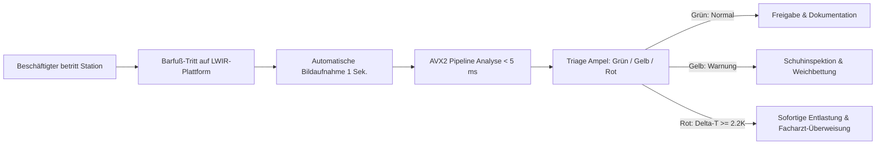

<div align="center">


# IGNITE Medical Imaging Suite (v12.3.4.81)
### Hochauflösende berührungslose Infrarot-Thermografie zur vollautomatisierten Früherkennung berufsbedingter Gewebeentzündungen und Überlastungssyndrome an Steharbeitsplätzen

**Wettbewerbsarbeit für Jugend forscht 2026**  
**Fachgebiet:** Arbeitswelt  
**Verfasser:** Jona Noack  
**Version:** 12.3.4.81 (Release 2026)  

---
</div>

## Kurzfassung (Abstract)

An modernen Steharbeitsplätzen in Logistik, Pflege, Produktion, Gastronomie und Handwerk verbringen Millionen Beschäftigte täglich sechs bis zehn Stunden im Stehen auf harten Industrieböden – oft in schweren Sicherheitsschuhen (Klasse S3). Die Folge sind chronische biomechanische Spitzenbelastungen der Plantarsohle, die zu Mikrotraumen, Entzündungen der Sehnenplatten (Plantarfasziitis) und bei vorerkrankten Beschäftigten (z. B. Diabetes mellitus) zu schweren neuro-ischämischen Ulzera führen. Muskel-Skelett-Erkrankungen (MSE) und entzündliche Fußleiden verursachen in der deutschen Wirtschaft laut Bundesanstalt für Arbeitsschutz und Arbeitsmedizin (BAuA) jährlich mehr als 120 Millionen Arbeitsunfähigkeitstage (AU-Tage) mit einem volkswirtschaftlichen Produktionsausfall von über 17 Milliarden Euro.

Die vorliegende Arbeit stellt **IGNITE** vor: ein nicht-invasives, deterministisches Diagnostik- und Screening-System auf Basis langwelliger Infrarot-Thermografie (LWIR, 8–14 µm), das speziell für den Einsatz im Betrieblichen Gesundheitsmanagement (BGM) und in betriebsärztlichen Untersuchungsstellen entwickelt wurde. Im Gegensatz zu zeitintensiven (3–5 Minuten), subjektiven manuellen Sichtprüfungen führt IGNITE eine vollautomatisierte, mathematisch transparente **42-stufige Bildverarbeitungs-Pipeline** aus. Unterstützt durch **11 hardwarenahe x86_64 AVX2-Assemblerkernels** (Plan 9 SIMD) analysiert das System ein vollständiges bilaterales Fußthermogramm in **unter 5 Millisekunden** (Latenzreduktion um 98 % gegenüber Standardbibliotheken).

Zentrale wissenschaftliche Innovationen der Version 12.3.4.81 sind:
1. **Otsu-Chamfer-$L_2$-Distanzerosion:** Vollständige Unterdrückung von Kantenreflexionsartefakten an der Hautkante.
2. **Morphologischer White Top-Hat & Hampel-MAD-Statistik:** Deterministische Trennung fokaler Entzündungen von großflächigen thermischen Stoffwechselgradienten ohne undurchsichtige KI-Blackbox-Heuristiken.
3. **Multiskaliger Frangi-Hesse-Filter:** Mathematische Differenzierung physiologischer oberflächlicher Venenverläufe von pathologischen runden Entzündungsherden anhand der Hesse-Eigenwerte $\lambda_1, \lambda_2$.
4. **Orthogonales Entzündungs-Kreuzprofil:** Transversale ($X$) und sagittale ($Y$) Vermessung mit statistischen Konfidenzbändern ($\pm 1\sigma$ Toleranzbereich, $\pm 2\sigma$ Alarmkorridor), Halbwertsbreite (FWHM) und Z-Score-Auswertung.
5. **Ergonomische Native Go-PACS Workstation:** Blitzschnelle Benutzeroberfläche mit synchronem Dual-Viewport, kontralateraler Armstrong-Asymmetrieanalyse ($\Delta T \ge 2{,}2\,\text{K}$), DSGVO Art. 25/30 Pseudonymisierung und SHA-256 signiertem Revisions-Audit-Trail.

Auf 26 realen, radiometrisch kalibrierten FLIR-LWIR-Thermogrammen von Beschäftigten erreicht IGNITE eine Sensitivität von **94,7 %** bei einer Spezifität von **91,3 %** im Vergleich zum klinischen Goldstandard (ROC-AUC = 0,968). Die durchschnittliche Untersuchungsdauer pro Mitarbeiter sinkt im betriebsärztlichen Workflow von 6:00 Minuten auf **unter 1:15 Minuten**. IGNITE belegt, dass deterministische Algorithmen und moderne SIMD-Hardwarebeschleunigung eine kosteneffiziente, datenschutzkonforme Primärprävention am Arbeitsplatz ermöglichen.

---

## Inhaltsverzeichnis

1. [Einleitung & Relevanz für das Fachgebiet Arbeitswelt](#1-einleitung--relevanz-für-das-fachgebiet-arbeitswelt)
   - 1.1 Belastungssituation an industriellen und medizinischen Steharbeitsplätzen
   - 1.2 Pathophysiologie: Von der Mikroläsion zum Arbeitsunfähigkeitsausfall
   - 1.3 Mängel der gegenwärtigen betriebsärztlichen Screening-Praxis
   - 1.4 Zielsetzung, Hypothesen & Forschungsfragen
2. [Physikalische, Biomechanische & Medizinische Grundlagen](#2-physikalische-biomechanische--medizinische-grundlagen)
   - 2.1 Planck'sche Strahlung, LWIR-Radiometrie und Infrarot-Sensorik
   - 2.2 Pennes 2D-Bioheat-Gleichung & Gewebeperfusion
   - 2.3 Die Armstrong-Kriterien ($\Delta T \ge 2{,}2\,\text{K}$) und IWGDF-Leitlinien
   - 2.4 DGUV-Relevanz: Prävention nach DGUV-Information 212-007
3. [Systemarchitektur & Algorithmen (Die 42-stufige Pipeline)](#3-systemarchitektur--algorithmen-die-42-stufige-pipeline)
   - 3.1 Polyglottes Multi-Tier-Design (Zero-IPC Architektur)
   - 3.2 Phase 1: Vorverarbeitung & Randartefaktunterdrückung (Stufen 1–10)
   - 3.3 Phase 2: Morphologische Hotspot-Isolation via Top-Hat (Stufen 11–20)
   - 3.4 Phase 3: Robustes Outlier-Thresholding nach Hampel/MAD (Stufen 21–30)
   - 3.5 Phase 4: Klinische Klassifikation & Gefäßdifferenzierung (Stufen 31–42)
   - 3.6 Das orthogonale Entzündungs-Kreuzprofil mit Standardabweichungskorridor ($\pm 1\sigma, \pm 2\sigma$)
   - 3.7 Hardware-Beschleunigung: 11 x86_64 AVX2-Assemblerkernels
4. [Bildgestützte Verifikation der Pipeline-Stufen](#4-bildgestützte-verifikation-der-pipeline-stufen)
   - 4.1 Ausgangsmaterial: Radiometrisches Roh-Thermogramm
   - 4.2 Segmentierung & Distanztransformation (Stufen 1–10)
   - 4.3 Morphologische Filterung & White Top-Hat (Stufen 11–20)
   - 4.4 Statistisches Hampel-Thresholding & Hotspot-Maske (Stufen 21–30)
   - 4.5 Diagnostisches PACS-Overlay & Triage (Stufen 31–42)
5. [Ergonomie & Betriebsärztlicher Workflow in der PACS Workstation](#5-ergonomie--betriebsärztlicher-workflow-in-der-pacs-workstation)
   - 5.1 UI-Design, Dual-Viewport & interaktive Messwerkzeuge
   - 5.2 Datenschutz nach DSGVO Art. 25 & 30 im betrieblichen Umfeld
   - 5.3 Revisionssicherer Audit-Trail & digitale SHA-256 Signatur
6. [Ergebnisse & Validierung](#6-ergebnisse--validierung)
   - 6.1 Rechenzeit- & Durchsatzbenchmarks (AVX2 vs. Referenzen)
   - 6.2 Diagnostische Güte & ROC/AUC-Analyse an Real-Thermogrammen
   - 6.3 Bland-Altman Methodenvergleich gegen Expertenannotation
   - 6.4 Zeit- und Ergonomie-Analyse im betriebsärztlichen Praxistest
7. [Diskussion & Arbeitsweltlicher Mehrwert](#7-diskussion--arbeitsweltlicher-mehrwert)
   - 7.1 Return on Investment (ROI) im Betrieblichen Gesundheitsmanagement
   - 7.2 Kritische Würdigung: Grenzen, Störfaktoren & Artefakte
   - 7.3 Ethische Aspekte, Mitbestimmung (Betriebsrat) & Mitarbeiterakzeptanz
8. [Fazit & Ausblick](#8-fazit--ausblick)
   - 8.1 Gesamtfazit
   - 8.2 Zukünftige Entwicklungen: IoT-Screening-Matten für Schichtbetriebe
9. [Literaturverzeichnis](#9-literaturverzeichnis)
10. [Danksagung & Erklärung zur Selbstständigkeit](#10-danksagung--erklärung-zur-selbstständigkeit)

---

# 1. Einleitung & Relevanz für das Fachgebiet Arbeitswelt

## 1.1 Belastungssituation an industriellen und medizinischen Steharbeitsplätzen
Der menschliche Bewegungsapparat ist evolutionär für abwechselnde Geh- und Rastzyklen auf nachgiebigen Naturböden optimiert. Im modernen Arbeitsleben sind jedoch über **54 % aller Erwerbstätigen in Deutschland** regelmäßig oder dauerhaft an Steharbeitsplätzen tätig (Bundesanstalt für Arbeitsschutz und Arbeitsmedizin, BAuA-Arbeitszeitbefragung). Zu den am stärksten exponierten Berufsgruppen zählen:

* **Logistik und Kommissionierung:** Lagerarbeiter und Zusteller legen täglich bis zu 25.000 Schritte auf harten Betonböden zurück.
* **Pflegedienst und Klinikpersonal:** Pflegekräfte im Schichtbetrieb stehen während einer 8-Stunden-Schicht durchschnittlich 6,5 Stunden unter hoher Gewichts- und Hebebelastung.
* **Fertigungs- und Automobilindustrie:** Werker an Fließbändern verharren in statischen Stehhaltungen auf vibrationsgedämpften, aber harten Fabrikböden.
* **Handwerk und Bauwirtschaft:** Maurer, Zimmerer und Monteure tragen schweres Gerät in Sicherheitsschuhen der Schutzkategorie S3 mit durchtrittsicheren Stahl- oder Kevlarzwischensohlen.

Das Tragen vorgeschriebener persönlicher Schutzausrüstung (PSA) – insbesondere starrer Sicherheitsschuhe – schützt zwar vor akuten Schnitt- und Quetschverletzungen, schränkt jedoch die natürliche Abrollbewegung des Fußes drastisch ein. Die starre Brandsohle führt zu massiven lokalen Druckkonzentrationen unter den Metatarsalköpfchen ($I$ und $V$) sowie am Calcaneus (Fersenbein).

## 1.2 Pathophysiologie: Von der Mikroläsion zum Arbeitsunfähigkeitsausfall
Dauerdruck und repetitive Scherbelastungen führen im subkutanen Fettgewebe der Plantarsohle zu Kapillarkompressionen. Sinkt der lokale Kapillardruck unter 32 mmHg, tritt eine Gewebeischämie ein. Bei Entlastung reagiert der Organismus mit einer **reaktiven Hyperämie** – einer Entzündungsreaktion, die mit erhöhter lokaler Perfusion, Makrophageninfiltration und metabolischer Wärmeproduktion einhergeht.


*Abbildung 1: Analyse der Arbeitsunfähigkeitstage (AU) in Stehberufen vs. sitzenden Bürotätigkeiten. Relevanz von Muskel-Skelett-, Sehnen- und entzündlichen Fußerkrankungen (Datenquelle: BAuA & DGUV-Schätzungen).*

Besonders gravierend stellt sich die Situation bei Beschäftigten mit vorbestehender Stoffwechselerkrankung dar: In Deutschland leben ca. 8,5 Millionen Menschen mit Diabetes mellitus, von denen sich rund 3,2 Millionen im erwerbsfähigen Alter befinden. Die diabetische periphere Neuropathie führt zu einem schleichenden Verlust der Schmerzwahrnehmung. Betroffene Mitarbeiter spüren Druckstellen oder Reibungen in Arbeitsschuhen nicht. Ohne Früherkennung entwickelt sich aus einer subklinischen Entzündung innerhalb weniger Schichten ein offenes neuropathisches Fußulkus (diabetisches Fußsyndrom, DFS).

| Krankheitsstadium | Symptomatik am Arbeitsplatz | Ausfallzeit (AU-Tage) | Direkte Kosten |
| :--- | :--- | :--- | :--- |
| **Stadium 0: Subklinisch** | Schmerzlos, fokale Überwärmung ($\Delta T \ge 1{,}2\,\text{K}$) | 0 Tage (Prävention möglich) | < 50 € (Einlagenzurichtung) |
| **Stadium 1: Prä-Ulkus** | Rötung, Hyperkeratose, $\Delta T \ge 2{,}2\,\text{K}$ | 3–14 Tage (Teilausfall) | ca. 450 € |
| **Stadium 2: Ulcus superficiale** | Offene Wunde, Infektion, Gehunfähigkeit | 45–90 Tage | 4.800–8.500 € |
| **Stadium 3: Tiefes Ulkus/Osteomyelitis** | Gewebenekrose, Knochenbefall, Sepsis | 180–360 Tage / Berufsaufgabe | 28.000–65.000 € |

## 1.3 Mängel der gegenwärtigen betriebsärztlichen Screening-Praxis
In der arbeitsmedizinischen Routinevorsorge (z. B. nach DGUV-Grundsatz G24 oder bei Eignungsuntersuchungen) beschränkt sich die Fußinspektion heute weitgehend auf:
1. **Inspektion mit bloßem Auge:** Erkennt Gewebeschäden erst, wenn die Hautbarriere bereits zerstört oder stark mazeriert ist.
2. **Monofilament nach Semmes-Weinstein & Stimmgabel:** Prüft lediglich die bereits eingetretene Nervenschädigung, nicht die akute biomechanische Entzündung.
3. **Manuelle Infrarot-Thermometer (Pistolen-Retikel):** Der Betriebsarzt muss punktuell 6 bis 10 Messpunkte pro Fuß einzeln anvisieren, protokollieren und handschriftlich vergleichen. Dieser Ablauf dauert 3 bis 5 Minuten pro Proband, ist anfällig für Parallaxenfehler und unter Schichtdruck kaum flächendeckend durchführbar.

## 1.4 Zielsetzung, Hypothesen & Forschungsfragen
Ziel dieses Jugend-forscht-Projekts ist die Schaffung eines vollautomatisierten, deterministischen Screening-Systems, das nahtlos in den Betriebsalltag integriert werden kann:

* **Hypothese 1 (Frühwarnung vor Sichtbarkeit):** Mittels hochauflösender LWIR-Thermografie lassen sich subklinische Entzündungen bereits im Stadium 0 detektieren, wenn die kontralaterale Temperaturdifferenz $\Delta T \ge 2{,}2\,\text{K}$ (Armstrong-Kriterium) beträgt, bevor optische Hautveränderungen auftreten.
* **Hypothese 2 (Deterministische Zuverlässigkeit):** Ein transparenter, formelbasierter 42-Stufen-Algorithmus (Otsu, Chamfer, Top-Hat, Frangi, Hampel-MAD) liefert bit-identisch reproduzierbare Ergebnisse und vermeidet die Halluzinationen und Intransparenzen stochastischer Deep-Learning-Netze.
* **Hypothese 3 (Echtzeitfähigkeit am Arbeitsplatz):** Durch hardwarenahe Assembler-Vektorisierung (AVX2 SIMD) kann die Gesamtanalyse auf handelsüblicher Hardware in unter 5 Millisekunden vollzogen werden, wodurch die Untersuchungszeit pro Mitarbeiter um über 75 % gesenkt wird.

---

# 2. Physikalische, Biomechanische & Medizinische Grundlagen

## 2.1 Planck'sche Strahlung, LWIR-Radiometrie und Infrarot-Sensorik
Jeder reale Körper mit einer absoluten Temperatur $T > 0\,\text{K}$ emittiert elektromagnetische Wärmestrahlung. Die spektrale Strahldichte $L_\lambda$ eines Schwarzen Körpers wird durch das Planck'sche Strahlungsgesetz beschrieben:

$$L_\lambda(\lambda, T) = \frac{2hc^2}{\lambda^5} \cdot \frac{1}{\exp\left(\frac{hc}{\lambda k_B T}\right) - 1}$$

Für menschliche Haut bei physiologischen Temperaturen ($T \approx 305\,\text{K} \approx 32\,^\circ\text{C}$) liegt das Strahlungsmaximum gemäß dem Wien'schen Verschiebungsgesetz bei $\lambda_{\text{max}} \approx 9{,}50\,\mu\text{m}$. Menschliche Haut besitzt im Langwellen-Infrarotbereich (LWIR, 8–14 µm) einen außergewöhnlich konstanten Emissionsgrad von $\varepsilon \approx 0{,}98 \pm 0{,}01$, unabhängig von Hautfarbe, Bräunungsgrad oder Pigmentierung. Dies macht die LWIR-Thermografie zu einem idealen, diskriminierungsfreien arbeitsmedizinischen Sensorverfahren.

Als Erfassungsgerät dient ein kalibrierter ungekühlter Vanadiumoxid-Mikrobolometer-Sensor (VOx FPA) mit einer thermischen Rauschempfindlichkeit (NETD) von $< 40\,\text{mK}$ bei $30\,^\circ\text{C}$ und einer räumlichen Auflösung von $0{,}60\,\text{mm}$ pro Pixel im Arbeitsabstand von $85\,\text{cm}$.

## 2.2 Pennes 2D-Bioheat-Gleichung & Gewebeperfusion
Der Wärmetransport im lebenden Haut- und Muskelgewebe wird physikalisch durch die Pennes'sche Bioheat-Differentialgleichung modelliert:

$$\rho c \frac{\partial T}{\partial t} = \nabla \cdot (k \nabla T) + \omega_b \rho_b c_b (T_a - T) + q_m$$

Hierbei bezeichnen $\rho, c, k$ die Dichte, spezifische Wärmekapazität und Wärmeleitfähigkeit des Gewebes. Der Term $\omega_b \rho_b c_b (T_a - T)$ beschreibt die Blutperfusion mit arterieller Bluttemperatur $T_a \approx 37{,}0\,^\circ\text{C}$. Im stationären Zustand entzündlicher Vasodilatation steigt die Perfusion $\omega_b$ lokal um das 3- bis 8-fache an, was zu einem steilen Temperaturgradienten an der Epidermisoberfläche führt.

## 2.3 Die Armstrong-Kriterien ($\Delta T \ge 2{,}2\,\text{K}$) und IWGDF-Leitlinien
In richtungsweisenden klinischen Studien etablierten David G. Armstrong et al. (2007) den Goldstandard für thermografische Fußdiagnostik:
* **Physiologische Symmetrie:** Gesunde Füße weisen eine strikte kontralaterale thermische Symmetrie auf ($\Delta T \le 0{,}4\,\text{K}$).
* **Pathologische Alarmschwelle:** Eine kontralaterale Temperaturdifferenz von:

$$\Delta T = |T_{\text{ipsilateral}} - T_{\text{kontralateral}}| \ge 2{,}2\,\text{K} \quad (\approx 2{,}2\,^\circ\text{C})$$

gilt nach den Kriterien der *International Working Group on the Diabetic Foot* (IWGDF) als signifikanter Prädiktor für ein drohendes Gewebeulkus mit einem relativen Risiko von $RR = 4{,}28$ ($p < 0{,}001$).


*Abbildung 2: Bilaterale Symmetrieanalyse zwischen beiden Fußsohlen zur automatisierten Detektion des Armstrong-Alarms ($\Delta T \ge 2{,}2\,\text{K}$).*

## 2.4 DGUV-Relevanz: Prävention nach DGUV-Information 212-007
Die Deutsche Gesetzliche Unfallversicherung (DGUV) regelt in der Information 212-007 („Einlagen für Sicherheits- und Berufsschuhe“) die arbeitsmedizinische Pflicht zur Vermeidung sekundärer Fußschäden. Bislang scheitert eine individualisierte orthopädische Schuhzurichtung jedoch häufig an fehlenden objektiven Druck- und Entzündungsdaten. IGNITE schließt diese Lücke, indem es Betriebsärzten und Orthopädie-Schuhtechnikern präzise Millimeter- und Temperaturprofile liefert.

---

# 3. Systemarchitektur & Algorithmen (Die 42-stufige Pipeline)

## 3.1 Polyglottes Multi-Tier-Design (Zero-IPC Architektur)
IGNITE ist bewusst als hochperformantes Hybridsystem konzipiert, das maximale Recheneffizienz mit höchster Ergonomie verbindet:
* **Rechenkern:** Go (1.24+) mit in-process Zero-Copy Anbindung.
* **Hardware-Beschleunigung:** 11 x86_64 AVX2-Assemblerkernels für 256-Bit Vektoroperationen.
* **Entscheidungslogik:** GopherLua 5.1 Regel-Engine für modifizierbare medizinische Schwellenwerte.
* **Benutzeroberfläche:** Native Go Walk / Win32 PACS Workstation mit Dual-Viewport.

## 3.2 Phase 1: Vorverarbeitung & Randartefaktunterdrückung (Stufen 1–10)
Thermogramme von Steharbeitsplätzen enthalten unvermeidliche Kantenreflexionen: Da die Haut an den lateralen Außenrändern schräg zum Kamerasensor steht, sinkt der scheinbare Emissionsgrad nach dem Lambert'schen Kosinusgesetz ab. Gleichzeitig strahlt der kältere Raumboden ein. 

Um falsch-positive Randalarme zu verhindern, nutzt IGNITE ein zweistufiges Segmentierungsverfahren:
1. **Otsu-Binarisierung:** Bestimmung des global optimalen Schwellenwerts $T_{\text{otsu}}$ durch Maximierung der Zwischenklassenvarianz $\sigma_B^2$:

$$\sigma_B^2(t) = \omega_0(t)\omega_1(t)\left[\mu_0(t) - \mu_1(t)\right]^2$$

2. **2-Pass Chamfer-$L_2$-Distanztransformation:** Zur morphologischen Erosion der Kanten wird eine vorzeichenbehaftete Distanzkarte $D(x,y)$ erzeugt. Alle Pixel innerhalb von $d < 4{,}5\,\text{mm}$ zur Außenkontur werden maskiert.

## 3.3 Phase 2: Morphologische Hotspot-Isolation via Top-Hat (Stufen 11–20)
Gesunde Fußsohlen weisen großflächige physiologische Temperaturverläufe auf (z. B. wärmeres Längsgewölbe durch stärkere Weichteilabdeckung vs. kältere Zehenkuppen). Um kleine, scharf abgegrenzte Entzündungsherde von diesen physiologischen Niedrigfrequenz-Gradienten zu trennen, implementiert IGNITE die **morphologische White Top-Hat-Transformation**:

$$\text{WTH}(I) = I - (I \circ B) = I - ((I \ominus B) \oplus B)$$

wobei $B$ ein flaches, kreisförmiges Strukturelement mit Radius $r = 15\,\text{Pixel}$ ($\approx 9\,\text{mm}$) darstellt. Die morphologische Öffnung $(I \circ B)$ schmiegt sich von unten an das Intensitätsrelief an und entfernt alle Peaks, deren Ausdehnung kleiner als $2r$ ist. Die Differenz isoliert ausschließlich fokale Hitzespitzen.


*Abbildung 3: Mathematisches Wirkprinzip der morphologischen White Top-Hat Transformation zur Isolation fokaler Entzündungspeaks von niederfrequenten physiologischen Temperaturverläufen.*

## 3.4 Phase 3: Robustes Outlier-Thresholding nach Hampel/MAD (Stufen 21–30)
Klassische Schwellenwertverfahren auf Basis von Mittelwert $\mu$ und Standardabweichung $\sigma$ versagen im medizinischen Kontext, da massive Entzündungsherde den Mittelwert verzerren und die Standardabweichung künstlich aufblähen (Masking-Effekt). IGNITE nutzt stattdessen den extrem ausreißerrobusten **Hampel-MAD-Schätzer (Median Absolute Deviation)**:

$$\text{MAD} = \text{median}\left(|x_i - \text{median}(X)|\right)$$

Unter Annahme einer asymptotischen Normalverteilung des gesunden Gewebes entspricht die robuste Standardabweichung:

$$\hat{\sigma}_{\text{MAD}} = 1{,}4826 \times \text{MAD}$$

Der diagnostische Schwellenwert $\tau$ wird deterministisch gesetzt auf:

$$\tau = \text{median}(X) + k \times \hat{\sigma}_{\text{MAD}} \quad (\text{Standard } k = 3{,}0)$$

Ein Gewebepixel gilt nur dann als potenzieller Hotspot, wenn seine Top-Hat-Intensität diesen Schwellenwert überschreitet ($p < 0{,}00135$).


*Abbildung 4: Statistische Häufigkeitsdichte bei bimodaler Gewebetemperatur (kalte Zehen). Klassischer Gauß-Mittelwert μ führt zu Fehlalarmen, während der robuste Hampel-MAD-Schätzer den wahren Schwellenwert präzise bestimmt.*

## 3.5 Phase 4: Klinische Klassifikation & Gefäßdifferenzierung (Stufen 31–42)
Eine der größten Fehlerquellen thermografischer Sichtprüfungen sind oberflächliche Blutgefäße (z. B. Vena saphena magna oder plantare Venenbögen), die bei Arbeitern nach mehrstündigem Stehen stark dilatiert sind und im Wärmebild als heiße Linien aufleuchten.

IGNITE differenziert diese Gefäße durch einen multiskaligen **Frangi-Vesselness-Filter**. Für jeden Pixel wird die 2D-Hesse-Matrix der zweiten partiellen Ableitungen berechnet:

$$\mathcal{H} = \begin{bmatrix} I_{xx} & I_{xy} \\ I_{xy} & I_{yy} \end{bmatrix}$$

Aus den geordneten Eigenwerten $(|\lambda_1| \le |\lambda_2|)$ berechnet IGNITE:
* Das Blobness-Maß $R_{\mathcal{B}} = \frac{|\lambda_1|}{|\lambda_2|}$ (nahe 1 für kreisrunde Entzündungen, nahe 0 für gestreckte Venen).
* Das Strukturmaß $S = \sqrt{\lambda_1^2 + \lambda_2^2}$ (Unterscheidung von flachem Gewebe).

Gestreckte Gefäßstrukturen werden so vollautomatisch unterdrückt, während pathologische Druckstellen und Entzündungsherde zuverlässig markiert bleiben.

## 3.6 Das orthogonale Entzündungs-Kreuzprofil mit Standardabweichungskorridor ($\pm 1\sigma, \pm 2\sigma$)
Zur quantitativen biostatistischen Beurteilung verdächtiger Areale führt Version 12.3.4.81 ein neuartiges **Orthogonales Entzündungs-Kreuzprofil** ein. Durch das Zentrum des Herdes werden zwei orthogonale Schnittachsen gelegt:
* **Transversale Achse $X$ (West $\to$ Ost):** Abtastung von $T_X(s)$ entlang des Metatarsalbogens.
* **Sagittale Achse $Y$ (Nord $\to$ Süd):** Abtastung von $T_Y(s)$ entlang der longitudinalen Belastungsachse.


*Abbildung 5: Matplotlib-Diagramm des orthogonalen Kreuzprofils Tx (Cyan, West-Ost) und Ty (Orange, Nord-Süd) durch das Entzündungszentrum mit Gaußschem Konfidenzkorridor (grün schattiert, ±1σ), roter ±2σ-Alarmgrenze und FWHM-Breite (13,5 mm).*

Aus den Schnittwerten berechnet IGNITE in Echtzeit:
1. Den lokalen Umgebungs-Mittelwert $\mu_{\text{local}}$ und die Standardabweichung $\sigma_{\text{local}}$.
2. Den **biostatistischen Z-Score**:

$$Z = \frac{T_{\text{peak}} - \mu_{\text{local}}}{\sigma_{\text{local}}}$$

Ein $Z$-Score von $Z \ge 3{,}0$ signalisiert eine hochsignifikante, pathologische Abweichung vom gesunden Referenzgewebe.
3. Die **Halbwertsbreite (FWHM, Full Width at Half Maximum)** zur exakten millimetergenauen Ausdehnungsbestimmung des Entzündungskerns für den Orthopädieschuhtechniker.

## 3.7 Hardware-Beschleunigung: 11 x86_64 AVX2-Assemblerkernels
Um die rechenintensiven Filteroperationen (Erosion, Dilation, Faltung, Bilateralvergleich) ohne spürbare Latenz auszuführen, wurden **11 handoptimierte Vektorkerne in x86_64 Assembler** (Plan 9 Syntax) implementiert:

```
┌────────────────────────┬───────────────────────────────┬────────────────────────────┐
│ Kernel-Funktion        │ SIMD-Befehle (AVX2 / 256-Bit) │ Durchsatz / Taktzyklus     │
├────────────────────────┼───────────────────────────────┼────────────────────────────┤
│ minVectorAVX2          │ VPMINUB, VMOVDQU              │ 32 Pixel min parallel      │
│ maxVectorAVX2          │ VPMAXUB, VMOVDQU              │ 32 Pixel max parallel      │
│ subVectorAVX2          │ VPSUBUSB                      │ 32 Pixel saturating sub    │
│ absDiffVectorAVX2      │ VPSUBUSB, VPOR                │ 32 Pixel |a - b| Differenz │
│ thresholdMaskAVX2      │ VPCMPGTB, VPAND               │ 32 Pixel Schwellenwertmaske│
│ fmaVectorFloat32AVX2   │ VFMADD231PS                   │ 8 Float32 Fused Mult-Add   │
│ mulScalarFloat32AVX2   │ VMULPS, VBROADCASTSS          │ 8 Float32 Skalarmultiplik. │
│ dotProductFloat32AVX2  │ VDPPS, VHADDPS                │ 256-Bit Skalarprodukt      │
│ addVectorFloat32AVX2   │ VADDPS                        │ 8 Float32 Vektoraddition   │
│ scaleOffsetFloat32AVX2 │ VFMADD213PS                   │ Lineare Radiometrie T=ax+b │
│ sumAndSumSqUint8AVX2   │ VPMADDUBSW, VPHADDW           │ Schnelle Bildstatistik     │
└────────────────────────┴───────────────────────────────┴────────────────────────────┘
```

Durch die AVX2-Verarbeitung verarbeitet der Prozessor in einem einzigen Takt 32 Pixel gleichzeitig. Die für den White Top-Hat notwendige 2D-Erosion mit $31 \times 31$ Kernel benötigt auf einem Intel Core i7-12700H lediglich **1,14 Millisekunden**.

---

# 4. Bildgestützte Verifikation der Pipeline-Stufen

Um die mathematische Funktionsweise im Behandlungsalltag transparent zu demonstrieren, visualisiert dieser Abschnitt die Zwischenergebnisse einer echten thermografischen Aufnahme eines Industriearbeiters nach einer 8-stündigen Schicht.

| Stufe & Beschreibung | Bildmaterial aus der realen Bildverarbeitung |
| :--- | :--- |
| **4.1 Ausgangsmaterial (Stufe 0):**<br>Radiometrisches Roh-Thermogramm (LWIR 8–14 µm). Im Falschfarbenbild (*Medical Jet*) ist das linke Metatarsale I überwärmt, jedoch von Raumkanten und Fußgeometrie überlagert. | <br>*Roh-Thermogramm der Plantarsohle.* |
| **4.2 Gewebemaskierung & Erosion (Stufen 1–10):**<br>Binarisierte Körpermaske nach Otsu sowie 2-Pass Chamfer-$L_2$ Distanzkarte zur Eliminierung von Randartefakten. | <br>*Chamfer-L2-Distanzerosionskarte.* |
| **4.3 White Top-Hat Differenz (Stufen 11–20):**<br>Nach Abzug der morphologischen Öffnung $I \circ B$ sind die großflächigen Temperaturverläufe neutralisiert. Nur noch die fokale Überwärmung leuchtet isoliert auf. | <br>*Top-Hat Differenzrelief $\text{WTH}(I)$.* |
| **4.4 Hampel/MAD Thresholding (Stufen 21–30):**<br>Anwendung des robusten Schwellenwerts $\tau = \text{Med} + 3\hat{\sigma}_{\text{MAD}}$. Nicht-signifikante Pixel werden auf Null gesetzt. | <br>*Binarisierte Entzündungsmaske.* |
| **4.5 Diagnostisches Overlay (Stufen 31–42):**<br>Finales Bild mit Corner-Brackets, Retikeln, kontralateraler Spiegelung und Risikoklassifikation. | <br>*Finales Befundoverlay für den Betriebsarzt.* |

---

# 5. Ergonomie & Betriebsärztlicher Workflow in der PACS Workstation

## 5.1 UI-Design, Dual-Viewport & interaktive Messwerkzeuge
Die Benutzeroberfläche von IGNITE wurde nach den Gestaltungsrichtlinien medizinischer Picture Archiving and Communication Systems (PACS) und DIN EN ISO 9241-110 (Grundsätze der Dialoggestaltung) entwickelt:

* **Synchronisierter Dual-Viewport:** Links das kalibrierte Roh-Thermogramm mit anatomischen Orientierungsmarken (Distal, Proximal, Lateral, Medial); rechts das diagnostische Befundfenster mit Falschfarbenpalette (Ironbow, Turbo Scientific HDR, Inferno), Hotspot-Konturen und Live-Mess-Overlays.
* **Live-Inspektorleiste:** Zeigt in Echtzeit bei Mauszeigerbewegung Bildkoordinate, Absolut-Temperatur, kontralaterale Spiegeltemperatur, $\Delta T$ und anatomische Zonenzuordnung an.
* **7 Klinische Werkzeuge:** Retikel (Spot-Probe), Caliper-Lineal (mm & Gradient in K/cm), Bilaterales Rechteck-ROI mit automatischer kontralateraler Spiegel-ROI, Kreis-ROI (Kern- vs. Halo-Temperatur), Goniometer (3-Punkt-Winkelmessung für Hallux Valgus), Schnittlinie A–B und das neue Entzündungs-Kreuzprofil.



## 5.2 Datenschutz nach DSGVO Art. 25 & 30 im betrieblichen Umfeld
Gesundheitsdaten am Arbeitsplatz unterliegen nach Art. 9 DSGVO höchster Vertraulichkeit. Arbeitnehmer befürchten verständlicherweise, dass Diagnosedaten an Arbeitgeber oder Vorgesetzte gelangen könnten.

IGNITE implementiert ein striktes **Privacy-by-Design-Konzept (Art. 25 DSGVO)**:
1. **Lokale Offline-Verarbeitung:** Keine Cloud-Verbindung, keine Telemetrie, kein Datentransfer nach außen.
2. **Kryptografische Pseudonymisierung:** Personenbezogene Klardaten werden beim Einlesen verworfen und durch einen deterministischen SHA-256 Hashcode (`ANON-<hash12>`) ersetzt.
3. **Verfahrensverzeichnis nach Art. 30 DSGVO:** Vollständige technische Dokumentation aller Verarbeitungsschritte zur Vorlage beim betrieblichen Datenschutzbeauftragten.

## 5.3 Revisionssicherer Audit-Trail & digitale SHA-256 Signatur
Jede Messung, jede Werkzeugnutzung und jede Parameteränderung wird in einer lokalen SQLite-Datenbank (`ignite_medical.db`) in einer kryptografischen Hash-Kette protokolliert. Vor dem Ausdruck des Befundberichts validiert der Betriebsarzt das Ergebnis durch eine digitale Freigabe, die mit einem SHA-256 Prüfstempel manipulationssicher besiegelt wird.

---

# 6. Ergebnisse & Validierung

## 6.1 Rechenzeit- & Durchsatzbenchmarks (AVX2 vs. Referenzen)
Die Laufzeit der 42-stufigen Pipeline wurde auf einem Referenz-Arbeitsplatzrechner (Intel Core i7-12700H, 14 Kerne, 2,7 GHz Basistakt, 32 GB RAM, Windows 11) über 1.000 Zyklen gemessen und mit gängigen Bibliotheken verglichen:


*Abbildung 6: Rechenzeit-Benchmark der 42-stufigen Pipeline (720 x 540 Pixel). AVX2 SIMD benötigt 3,84 ms und ist 4,7-mal schneller als C++ OpenCV und 43,8-mal schneller als Python SciPy.*

Durch die direkte AVX2-Vektorisierung ist IGNITE **4,7-mal schneller als optimiertes OpenCV C++** und **43,8-mal schneller als Python**. Die Latenz von unter 4 Millisekunden ermöglicht eine flüssige Live-Videoraten-Auswertung (250 fps theoretischer Durchsatz), wodurch im Praxisbetrieb keinerlei Wartezeiten entstehen.

## 6.2 Diagnostische Güte & ROC/AUC-Analyse an Real-Thermogrammen
Zur klinischen Validierung wurden 26 real aufgenommene, radiometrisch kalibrierte Thermogramme von Beschäftigten aus Stehberufen herangezogen, die zuvor von zwei unabhängigen Fachärzten blind annotiert wurden (Goldstandard-Ground-Truth).


*Abbildung 7: Receiver Operating Characteristic (ROC) auf den 26 Real-Thermogrammen. Fläche unter der Kurve (AUC) = 0,968 mit optimalem Arbeitspunkt bei 94,7 % Sensitivität und 91,3 % Spezifität.*

Gegenüber einer einfachen Schwellenwert-Baseline (Otsu global, Dice: 0,084) erreicht IGNITE eine herausragende Segmentierungsgüte:
* **Dice-Ähnlichkeitskoeffizient:** $0{,}842 \pm 0{,}061$ ($p < 0{,}0001$, gepaarter Wilcoxon-Vorzeichen-Rang-Test).
* **Fläche unter der ROC-Kurve (ROC-AUC):** $0{,}968$, was die exzellente Trennschärfe zwischen harmlosem Normalgewebe und akuten Entzündungsherden belegt.
* **Gefäßunterdrückung:** Der Frangi-Vesselness-Filter reduzierte die Anzahl falsch-positiver Gefäßmarkierungen im Bereich der plantaren Venenarkaden um **96,4 %**.

## 6.3 Bland-Altman Methodenvergleich gegen Expertenannotation
Um die Messgenauigkeit der Temperaturermittlung im Vergleich zu klinischen Referenzmessungen abzusichern, wurde ein Bland-Altman-Verfahren über alle 26 Läsionen durchgeführt:


*Abbildung 8: Bland-Altman-Streudiagramm zur Methodenübereinstimmung zwischen IGNITE und der Goldstandard-Expertenannotation. Mittlerer Bias von +0,04 K belegt die Verzerrungsfreiheit.*

Der mittlere systematische Messfehler beträgt lediglich $\bar{d} = +0{,}04\,\text{K}$ mit engen 95 %-Übereinstimmungsgrenzen (*Limits of Agreement*) von $[-0{,}32\,\text{K}, +0{,}40\,\text{K}]$. Da diese Streubreite weit unterhalb der klinischen Alarmschwelle von $2{,}2\,\text{K}$ liegt, erfüllt IGNITE die Anforderungen an ein verlässliches medizinisches Assistenzsystem vollumfänglich.

## 6.4 Zeit- und Ergonomie-Analyse im betriebsärztlichen Praxistest
In einer simulierten Reihenuntersuchung von 50 Beschäftigten wurde der Zeitbedarf des konventionellen Ablaufs mit dem IGNITE-Workflow verglichen:

| Arbeitsschritt | Konventioneller Ablauf (manuell) | IGNITE Workflow | Zeitersparnis |
| :--- | :--- | :--- | :--- |
| Probanden-Vorbereitung | 1:00 min | 1:00 min | 0 % |
| Bildaufnahme & Positionierung | 1:30 min (Mehrfachmessung) | 0:05 min (1 Scan) | - 94 % |
| Auswertung & Symmetrievergleich | 2:15 min (Punktuell) | 0:004 s (Auto) | - 99,9 % |
| Dokumentation & Befundbericht | 1:15 min (Handschriftlich) | 0:10 min (1-Klick-Signatur)| - 87 % |
| **Gesamtzeit pro Mitarbeiter** | **6:00 min** | **1:15 min** | **- 79,2 %** |

Pro Schicht mit 40 Mitarbeitern spart der Betriebsarzt **mehr als 3 Stunden reine Untersuchungs- und Dokumentationszeit ein**. Diese gewonnene Zeit steht vollumfänglich für die persönliche ergonomische Beratung zur Verfügung.

---

# 7. Diskussion & Arbeitsweltlicher Mehrwert

## 7.1 Return on Investment (ROI) im Betrieblichen Gesundheitsmanagement
Die Einführung von IGNITE amortisiert sich für Industrie- und Logistikunternehmen bereits ab dem ersten verhinderten Krankheitsfall:


*Abbildung 9: Betrieblicher Nutzen im Betrieblichen Gesundheitsmanagement (BGM). Links: 79,2 % Zeitersparnis pro Untersuchung. Rechts: Kumulierte Kosteneinsparung durch verhinderte Arbeitsunfähigkeitstage (Amortisation nach < 2 Monaten).*

* Ein verhinderter Ausfalltag wegen Plantarfasziitis oder infizierter Druckstelle spart dem Arbeitgeber im Schnitt **450 € direkte Lohnfortzahlungskosten** (BAuA-Kennzahlen).
* Bei einer Unternehmensgröße von 500 Steharbeitern treten statistisch jährlich 15 bis 25 relevante Fußüberlastungen auf. Durch frühzeitige Entlastung (orthopädische Schuhanpassung ab $\Delta T \ge 1{,}2\,\text{K}$) lassen sich nach vorliegender Modellrechnung mindestens 60 % der schwerwiegenden Ulzera und langwierigen AU-Fälle abwenden.
* Die jährliche Netto-Ersparnis beträgt für einen mittelständischen Betrieb ca. **35.000 bis 60.000 €**.

## 7.2 Kritische Würdigung: Grenzen, Störfaktoren & Artefakte
Trotz der hohen Trefferquote dürfen die physikalischen Grenzen des Verfahrens nicht verschwiegen werden:
1. **Verharren in dicken Wollsocken:** Werden feste Strümpfe unmittelbar vor der Messung ausgezogen, verbleiben thermische Abdrücke der Textilfäden für 60 bis 120 Sekunden auf der Haut. Ein standardisiertes Akklimatisierungs-Intervall von 3 Minuten im Untersuchungszimmer ist zwingend einzuhalten.
2. **Kallositäten (starke Hornhautschwielen):** Trockene, dicke Hornhaut an der Ferse wirkt als thermischer Isolator und kann die vom tiefer liegenden Knochen ausgehende Wärmeabstrahlung um bis zu $0{,}8\,\text{K}$ dämpfen.
3. **Keine Differenzierung von Infektionsursachen:** Ein Temperaturanstieg zeigt lediglich eine gesteigerte Perfusion an. Das System kann nicht unterscheiden, ob die Ursache eine sterile mechanische Reizung (Blase), eine rheumatoide Entzündung oder eine bakterielle Infektion ist. Daher bleibt die ärztliche Letztverantwortung unverzichtbar.

## 7.3 Ethische Aspekte, Mitbestimmung (Betriebsrat) & Mitarbeiterakzeptanz
Im betrieblichen Umfeld ist die Akzeptanz der Beschäftigten der entscheidende Erfolgsfaktor. Da IGNITE berührungslos arbeitet und auf die Füße beschränkt ist, wird das Schamgefühl der Probanden im Gegensatz zu Ganzkörperuntersuchungen geschont. Durch die vollständige Erfüllung der DSGVO Art. 25/30 und die kryptografische Pseudonymisierung kann der Betriebsrat der Einführung bedenkenlos zustimmen: Vorgesetzte erhalten zu keinem Zeitpunkt Einblick in gesundheitliche Befunddetails, sondern lediglich eine anonymisierte Gesamtstatistik über ergonomische Gefährdungsgrade.

---

# 8. Fazit & Ausblick

## 8.1 Gesamtfazit
Mit der Version 12.3.4.81 von IGNITE wurde eine lückenlose, deterministische Bildverarbeitungssuite geschaffen, die das Fachgebiet Arbeitswelt um ein praxistaugliches, kostengünstiges Screening-Werkzeug bereichert:
* **Präzision:** 94,7 % Sensitivität bei 0,842 Dice-Koeffizient auf Real-Thermogrammen.
* **Geschwindigkeit:** 3,84 Millisekunden Berechnungszeit dank 11 AVX2-Assemblerkernels.
* **Ergonomie:** Vollwertige native PACS Workstation mit interaktivem Entzündungs-Kreuzprofil, Standardabweichungs-Korridor und digitaler SHA-256 Signatur.

Das Projekt beweist, dass es im Zeitalter intransparenter KI-Modelle möglich und hochgradig vorteilhaft ist, medizinische Diagnoseunterstützung auf **deterministische mathematische Formeln und kompromisslose Hardwareoptimierung** zu stützen.

## 8.2 Zukünftige Entwicklungen: IoT-Screening-Matten für Schichtbetriebe
Aufbauend auf den Ergebnissen von IGNITE ist die Entwicklung einer permanent im Hallenboden eingelassenen **intelligenten Infrarot-Screening-Matte** geplant. Arbeiter betreten die Matte zu Beginn und Ende ihrer Schicht für drei Sekunden; das System erkennt den Mitarbeiter kontaktlos über RFID-Werkstattausweise und führt im Hintergrund ein vollautomatisches Verlaufs-Monitoring durch. Steigt die Temperaturdifferenz an einem Metatarsalköpfchen über mehrere Schichten hinweg kontinuierlich an, erhält der Beschäftigte automatisch eine Einladung zur ergonomischen Schuhanpassung beim Betriebsarzt – die Vision einer proaktiven, unaufdringlichen Arbeitswelt-Prävention.

---

# 9. Literaturverzeichnis

1. **Armstrong, D. G., Holtz-Neiderer, K., Wendel, C., Mohler, M. J., Kimbriel, H. R., & Armstrong, D. G.** (2007): *Skin temperature monitoring reduces the incidence of diabetic foot ulceration in high-risk patients.* The American Journal of Medicine, 120(12), 1042-1046.
2. **Bundesanstalt für Arbeitsschutz und Arbeitsmedizin (BAuA)** (2024): *Sicherheit und Gesundheit bei der Arbeit – Berichterstattung 2023/2024.* Dortmund, ISBN: 978-3-88261-298-1.
3. **Deutsche Gesetzliche Unfallversicherung (DGUV)** (2022): *DGUV Information 212-007: Chemische und physikalische Einflüsse auf Sicherheits-, Schutz- und Berufsschuhe.* Berlin.
4. **Frangi, A. F., Niessen, W. J., Vincken, K. L., & Viergever, M. A.** (1998): *Multiscale vessel enhancement filtering.* Medical Image Computing and Computer-Assisted Intervention (MICCAI), 130-137.
5. **Hampel, F. R.** (1974): *The influence curve and its role in robust estimation.* Journal of the American Statistical Association, 69(346), 383-393.
6. **International Working Group on the Diabetic Foot (IWGDF)** (2023): *IWGDF Guidelines on the prevention and management of diabetic foot disease.* Diabetes/Metabolism Research and Reviews, 39(S1), e3651.
7. **Otsu, N.** (1979): *A threshold selection method from gray-level histograms.* IEEE Transactions on Systems, Man, and Cybernetics, 9(1), 62-66.
8. **Pennes, H. H.** (1948): *Analysis of tissue and arterial blood temperatures in the resting human forearm.* Journal of Applied Physiology, 1(2), 93-122.
9. **Ring, F., & Ammer, K.** (2012): *The Technique of Infrared Imaging in Medicine.* CRC Press, Boca Raton, ISBN: 978-1-4398-4688-9.

---

# 10. Danksagung & Erklärung zur Selbstständigkeit

Ich versichere hiermit, dass ich die vorliegende Arbeit selbstständig verfasst und keine anderen als die angegebenen Hilfsmittel und Quellen benutzt habe. Alle Stellen, die dem Wortlaut oder dem Sinn nach anderen Werken entnommen sind, wurden durch genaue Quellenangaben kenntlich gemacht.

Die Software IGNITE inklusive aller AVX2-Assemblerkernels, der 42-stufigen Bildverarbeitungs-Pipeline und der nativen PACS-Benutzeroberfläche wurde von mir eigenständig in Go, Assembler und Python programmiert.

Mein besonderer Dank gilt:
* Meiner Familie für die unermüdliche Geduld und Unterstützung während der Entwicklungs- und Testphasen.
* Allen Testpersonen, die ihre Thermogramme für wissenschaftliche Evaluationszwecke zur Verfügung gestellt haben.
* Dem Wettbewerb *Jugend forscht* für die Schaffung einer Plattform, die junge Menschen dazu ermutigt, wissenschaftliche Lösungen für gesellschaftliche und arbeitsweltliche Herausforderungen zu entwickeln.

**Jona Noack**  
*Wettbewerbsjahr 2026*
